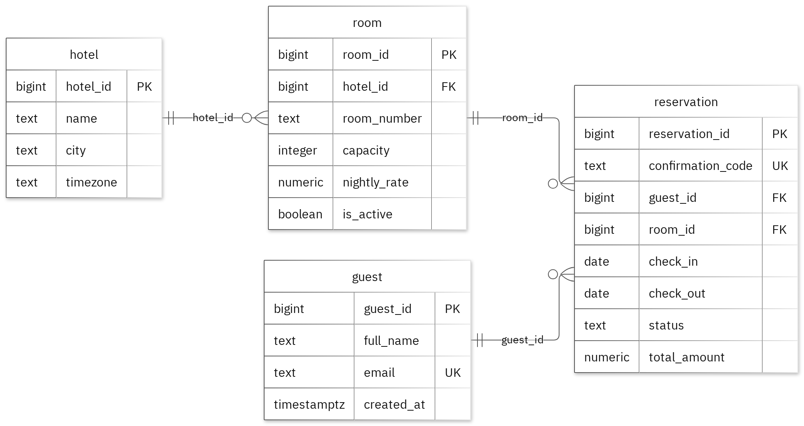

# MIT 8103 Advanced Database Systems

**Hotel Reservation System** · Flourish Kujah · Student ID 301927377

## Case study

I chose a Hotel Reservation System as my case study. The database supports guests who browse rooms and make reservations, and hotel staff who manage availability and review bookings. The schema is organised into four main tables: hotel, room, guest, and reservation. These tables handle the core operations such as finding available rooms, creating or cancelling reservations, and summarising booking activity.

## Portfolio 1: Database Design and Modelling

Each table has a primary key for unique identification and foreign keys to maintain relationships. Constraints enforce business rules, for example ensuring that room capacity is always greater than zero. Normalisation was demonstrated through examples at 1NF, 2NF, and 3NF, which eliminated redundancy and improved consistency. Invalid inserts were rejected while valid rows remained intact, confirming that the schema rules worked correctly.

Figure 1. Tables, keys and relationships. PK: primary key; FK: foreign key; UK: unique value.

<!-- PAGE BREAK -->

## Portfolio 2: Query Processing and Optimisation

I ran three SQL queries against the sample dataset. A join query returned the expected reservation record (CEDAR‑204‑A1 with Mira Chen). For performance testing, I created 20,000 rows and compared lookups before and after indexing. The median lookup time dropped from 0.865 ms to 0.228 ms, with identical results in both cases. The execution plan confirmed that the index was being used, showing how optimisation improves efficiency without changing the outcome.

## Portfolio 3: Transactions and Concurrency

I tested transaction behaviour using COMMIT, ROLLBACK, and READ COMMITTED isolation. An uncommitted update stayed hidden from other sessions, and ROLLBACK restored the earlier value. Without locks, concurrent increments produced inconsistent results. With SELECT FOR UPDATE, one session waited until the other completed, and the final counter value reflected all increments correctly. This showed why concurrency control is essential in multi‑user systems.

## Portfolio 4: NoSQL and Advanced Data Models

For the NoSQL part, I created a reservation_events collection in MongoDB. I inserted two sample event documents and ran four queries, all of which returned the expected results. Invalid inputs, like duplicate IDs or wrong date formats, were rejected. Using embedded documents allowed related details to stay together, while flexible fields supported different event types. These fictional events complement the relational schema, which continues to enforce strict rules in PostgreSQL.

## Repository and evidence

https://github.com/fkujah7377/Kujah_Flourish_301927377

The portfolio folders contain the SQL and JavaScript, explanations, query plans, result tables and screenshots.

<!-- PAGE BREAK -->

## Portfolio 5: Distributed and Cloud Database Exercise

I proposed a MongoDB replica set with three members across different failure zones. My discussion covered primary elections, majority acknowledgement, secondary lag, and sharding trade‑offs for the reservation_events collection. Replication improves availability, while backups ensure recovery. PostgreSQL would need its own availability plan, showing how relational and NoSQL systems approach resilience differently.

## Reflection

Separating hotel, room, guest, and reservation tables avoided duplication and simplified updates. Constraints like minimum room capacity were tested to ensure data integrity. The concurrency exercise showed how two sessions can read the same value before either update is committed, and why locking is necessary. The indexing experiment reinforced the importance of checking execution plans — the same query result can require very different amounts of work depending on optimisation.

## Declaration of AI Usage

I used GitHub Copilot and the portfolio generator to assist with preparing models, scripts, and explanations. The generator executed PostgreSQL and MongoDB tasks, validated outputs, and captured screenshots. I reviewed all results carefully and remain responsible for understanding and explaining the submitted work.

## References

- PostgreSQL Documentation: Constraints, EXPLAIN, Isolation, Row Locks
- MongoDB Documentation: Data Modelling, Replication, Sharding

